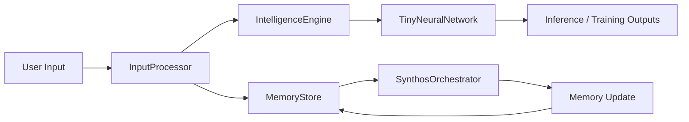

# Overall architecture

## Static overview

## Design notes

This diagram captures the current working architecture: input enters the system, is normalized, processed by intelligence and memory, then passed to the model, which returns a result that updates memory and workflow state.
