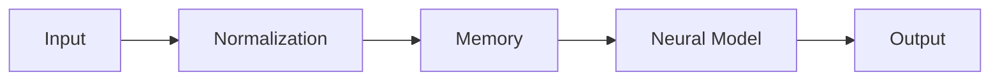

# Diagrams

This folder stores Mermaid and architecture visualizations for SYNTHOS.

## Included diagrams

- overall architecture
- memory architecture
- workflow overview
- neural network structure
- data flow lifecycle

## Mermaid examples

