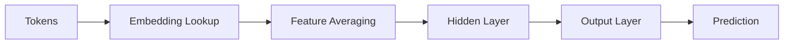

# Neural network execution workflow

The neural network workflow uses a compact feed-forward model for feature encoding and classification.

## Internal flow

## Current implementation

The `TinyNeuralNetwork` in `backend/app/synthos/neural_network.py` provides forward pass, loss calculation, and training step logic.
