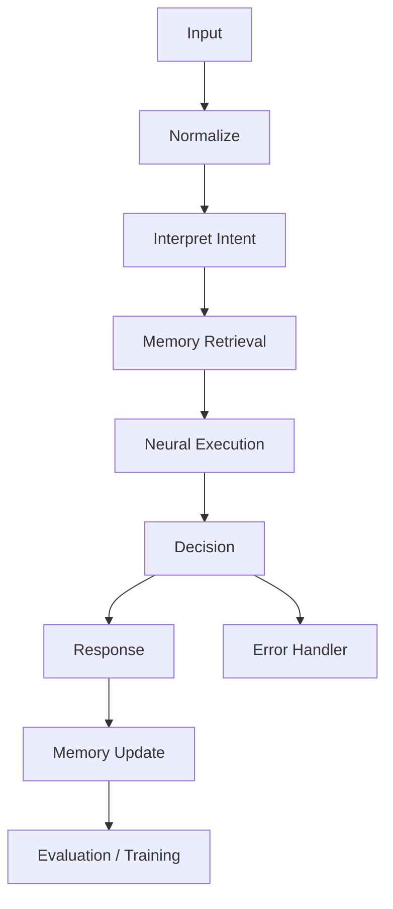

# Workflow overview

This project uses a staged workflow model that begins with incoming text and ends with a structured response or state update.

## Workflow stages

- WORKFLOW 01: Input Processing
- WORKFLOW 02: Intent and Task Understanding
- WORKFLOW 03: Context Retrieval
- WORKFLOW 04: Memory Management
- WORKFLOW 05: Neural Network Execution
- WORKFLOW 06: Intelligence Processing
- WORKFLOW 07: Response Generation
- WORKFLOW 08: Memory Update
- WORKFLOW 09: Model Training
- WORKFLOW 10: Model Evaluation
- WORKFLOW 11: Model Inference
- WORKFLOW 12: Error Recovery

